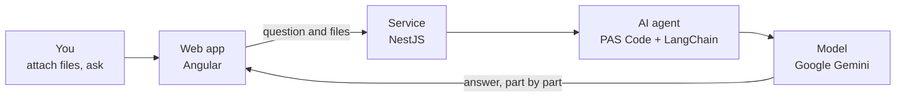

# PAS Agent Hub Car Insurance

**Send photos, reports, voice recordings and videos of a car insurance claim to an AI agent, and read its answer while it is written.**

PAS Agent Hub Car Insurance is a full-stack AI application: an Angular web app, a NestJS service, and an AI agent that reads images, text, audio and video together. It was built on top of the default project that [PAS Code](https://doc.scheer-pas.com/pas-code/latest/getting-started-with-pas-code) creates with a single command, so almost all of the work went into the feature itself.

---

## Contents

- [What you can do](#what-you-can-do)
- [Why it is useful](#why-it-is-useful)
- [Built with PAS Code](#built-with-pas-code)
- [How it works](#how-it-works)
- [Get started](#get-started)
- [Free to use](#free-to-use)
- [For developers](#for-developers)

---

## What you can do

| Feature                            | What it means for you                                                                                       |
| ---------------------------------- | ----------------------------------------------------------------------------------------------------------- |
| **Attach up to 10 files**          | Add photos of the damage, a written report, a recorded customer call and a short video to one question.     |
| **Four kinds of files**            | Images, text files, audio files and video files. The agent reads all of them together with your question.   |
| **Check before you send**          | Every attached file is listed with its kind and name. Remove the ones you do not want to include.           |
| **Live answers**                   | The answer appears character by character while the agent writes it, so you never stare at a spinner.       |
| **Ask again about the same files** | The files stay attached after an answer, so a follow-up question uses them without attaching them again.    |
| **Clear feedback**                 | A file that cannot be attached is named, together with the reason, for example an unsupported file type.    |
| **Private by design**              | Nothing is stored. The files are sent with your question and are gone from the service once it is answered. |

A typical exchange:

> **You:** Extract the customer info from attachments and summarize the issues list
>
> _Attached:_ `front.jpg` `rear.jpg` `damage-report.txt` `customer-call.mp3`
>
> **Agent:** Here's the extracted customer information and a summary of the issues.
> **Customer:** John Miller · **Vehicle:** Sedan ZX 2022 · **VIN:** ZX123456789 · **Report date:** 2026-04-24
> **1. Physical damage:** dents, scrapes and paint transfer on the front and rear doors on the driver's side …
> **2. Braking system malfunction (reported by John Miller):** a grinding noise when braking at moderate speed …

## Why it is useful

- **One question, all the evidence.** Photos, notes and a phone call about the same claim are read together, so the answer connects what each of them shows.
- **Faster first review.** Customer details and a list of issues are extracted in seconds, ready to be checked by a claims handler.
- **Works with what customers send.** Phone photos, voice messages and short videos are accepted as they are, with no conversion step.
- **No setup for users.** No accounts and no upload processing to wait for. Attach and ask.

## Built with PAS Code

PAS Code is the development framework of Scheer PAS Agent Hub for building business applications and services with AI. One command created a complete, working project, and this feature was built on top of it.

```bash
pas new pas-agent-hub-car-insurance
```

### What PAS Code provided on day one

| Out of the box              | What it gave this project                                                                               |
| --------------------------- | ------------------------------------------------------------------------------------------------------- |
| **Full-stack workspace**    | An Angular app and a NestJS service in one Nx monorepo, already connected to each other.                |
| **A working AI agent**      | An agent wired into the service, with its model configured in one JSON file.                            |
| **A starter page**          | Example cards with a text input, a workflow animation and a typewriter output, ready to extend.         |
| **Shared, validated types** | One place for the request and response types, checked on the server and typed in the app.               |
| **A typed service client**  | The app calls the service through a generated client, with the address taken from configuration.        |
| **Configuration layers**    | Defaults in the repository, personal settings such as API keys in a local file that is never committed. |
| **API documentation**       | Interactive OpenAPI docs for every endpoint at `/docs`, with no extra code.                             |
| **Quality tooling**         | Unit tests, linting, formatting and production builds, ready to run.                                    |
| **AI assistant skills**     | Guidance for Claude Code, Copilot and other assistants, so they write code the PAS way.                 |

### What we added

Because the foundation was already in place, the feature code stayed small:

| Part                                  | Size                                                              |
| ------------------------------------- | ----------------------------------------------------------------- |
| Multimodal input and streaming        | about **20 lines** in the agent, and **2 lines** of configuration |
| The whole service feature             | about **180 lines**: agent, streaming endpoint, file handling     |
| Shared request types                  | about **75 lines**, validated on the server                       |
| The Attach button and attachment list | a handful of focused Angular components                           |

Accepting files is mostly a matter of declaring it:

```typescript
@Agent({
  configKey: 'agents.carInsurance',
  agentName: 'car-insurance',
  systemPrompt: 'You are a helpful AI assistant. When files are attached to the prompt, use their content to answer.',
  userPrompt: '{{input.text}}',
})
export class CarInsuranceAgent extends DefaultAgent<MultimodalInput<CarInsurancePrompt>> {}
```

PAS Code takes care of the rest: connecting to the model, passing the files to it, and streaming the answer back. Switching the model is a change of configuration, not of code.

## How it works



1. You attach files in the browser. They stay in the browser tab until you send.
2. When you send, the app sends your question and all attached files to the service.
3. The service hands them to the AI agent, which asks the model and streams the answer back.
4. The app types the answer into the output area as it arrives.

The service keeps nothing between requests, so there is no database to run and no file to clean up.

## Get started

**You need:** Node.js 24.7 or later and a Google Gemini API key from [Google AI Studio](https://aistudio.google.com/apikey).

1. **Point npm at the PAS package registry** (once per machine):

   ```bash
   npm config set @pas:registry=https://npm.gitlab.scheer-group.com/
   ```

2. **Install the dependencies:**

   ```bash
   npm install
   ```

3. **Add your Gemini API key** to `packages/car-insurance/service/impl/src/config/local/config.json`. This file is never committed:

   ```json
   {
     "agents": {
       "carInsurance": { "model": { "apiKey": "AIza..." } }
     }
   }
   ```

4. **Point the app at your local service** in `packages/car-insurance/app/impl/public/config/local/config.json5`. This file is never committed either:

   ```json5
   {
     clients: {
       service: { baseUrl: 'http://localhost:8080' },
     },
   }
   ```

5. **Start the app and the service:**

   ```bash
   npm start
   ```

   or `pas start`, or `npx pas start`. The project brings its own [PAS CLI](https://doc.scheer-pas.com/pas-code/latest/getting-started-with-pas-code) (`@pas/cli`) at the same version as the other PAS packages, so no global installation is needed.

6. **Open [http://localhost:4200](http://localhost:4200)**, attach a few files in the Agent card, and ask your first question.

| Part              | Address                                                  |
| ----------------- | -------------------------------------------------------- |
| Web app           | [http://localhost:4200](http://localhost:4200)           |
| Service           | [http://localhost:8080](http://localhost:8080)           |
| API documentation | [http://localhost:8080/docs](http://localhost:8080/docs) |

The complete description of the feature, its limits, configuration and endpoint is in [packages/car-insurance/README.md](packages/car-insurance/README.md). If an installation step fails, see [Troubleshooting PAS Code](https://doc.scheer-pas.com/pas-code/latest/troubleshooting-pas-code).

## Free to use

**PAS Code is free, and so is everything in this project.** There is no paid edition and no license to buy: you can run, change, and extend all of it.

The same free version also lets agents go further, for example:

- **Conversation memory** that lasts beyond one request, so an agent can continue a claim conversation later.
- **Agent skills**: packaged instructions an agent looks up only when a request needs them, such as a claims checklist.

Want to see what PAS Agent Hub can do for your processes? Talk to one of our team members.

<a href="https://scheer-pas.com/en/agentic-ai-and-scheer-pas-the-next-step-in-process-automation/#form">
  
</a>

---

## For developers

### Running the tests

```bash
npx nx run-many -t test
```

### Debugging services

Services are built with webpack and the compiled output (including sourcemaps) is written to the **workspace-root `dist` folder**, for example `dist/packages/car-insurance/service/impl`. Any debug configuration must therefore map sourcemaps from `${workspaceFolder}/dist/**`, not from a project-local `dist` folder.

#### VS Code

A ready-to-use `.vscode/launch.json` is generated with two configurations:

| Configuration                     | What it does                                                                                                                                                  |
| --------------------------------- | ------------------------------------------------------------------------------------------------------------------------------------------------------------- |
| **Debug PAS service**             | Prompts for an Nx project name (for example `car-insurance-service`), runs `nx serve <project>` and attaches the debugger. Set a breakpoint and press **F5**. |
| **Attach to running PAS service** | Attaches to an already-running service on inspector port `9229`, useful when you started it with `npm start`.                                                 |

To debug a single service from scratch:

1. Open the **Run and Debug** panel (`⇧⌘D` / `Ctrl+Shift+D`).
2. Select **Debug PAS service** and press **F5**.
3. Enter the project name when prompted (for example `car-insurance-service`).

#### WebStorm / IntelliJ IDEA

1. Start the service with the inspector enabled:
   ```bash
   npx nx serve car-insurance-service --inspect
   ```
   Nx forwards `--inspect` to the Node process, which listens on port `9229`.
2. Create a **Run/Debug Configuration** → **Attach to Node.js/Chrome**.
3. Set **Host** to `localhost` and **Port** to `9229`, then start it.

WebStorm resolves sourcemaps from `dist/` automatically, so breakpoints in your TypeScript sources are hit.

### AI coding assistants

This project includes agent skills for PAS-specific guidance. To enable them in VS Code, see the [Agent Skills documentation](https://code.visualstudio.com/docs/copilot/customization/agent-skills). Project information for coding agents is in [.agents/AGENTS.md](.agents/AGENTS.md).
